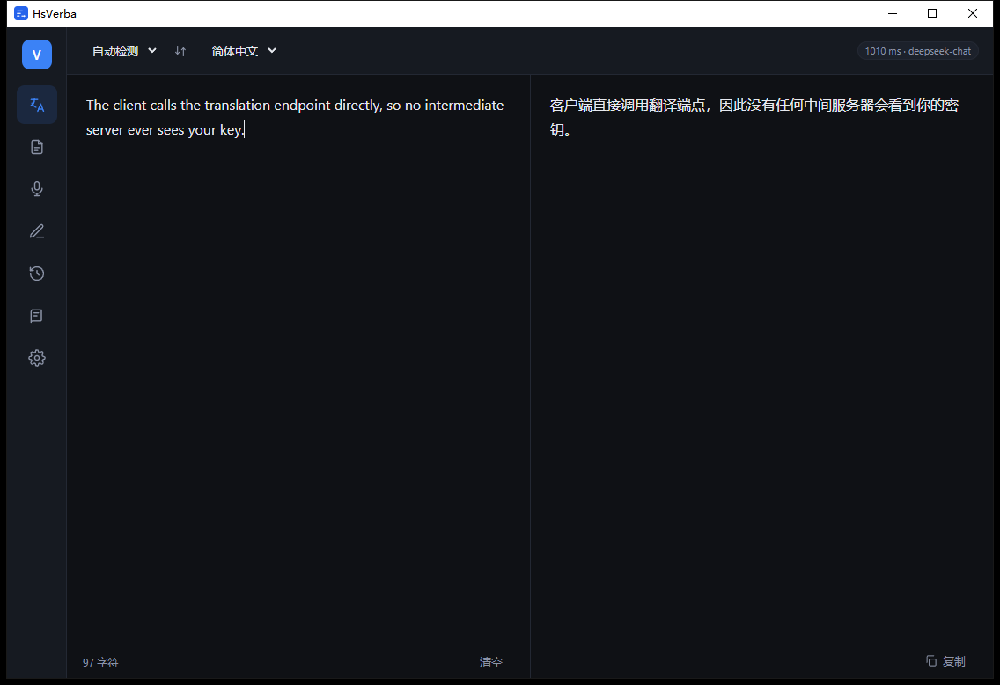
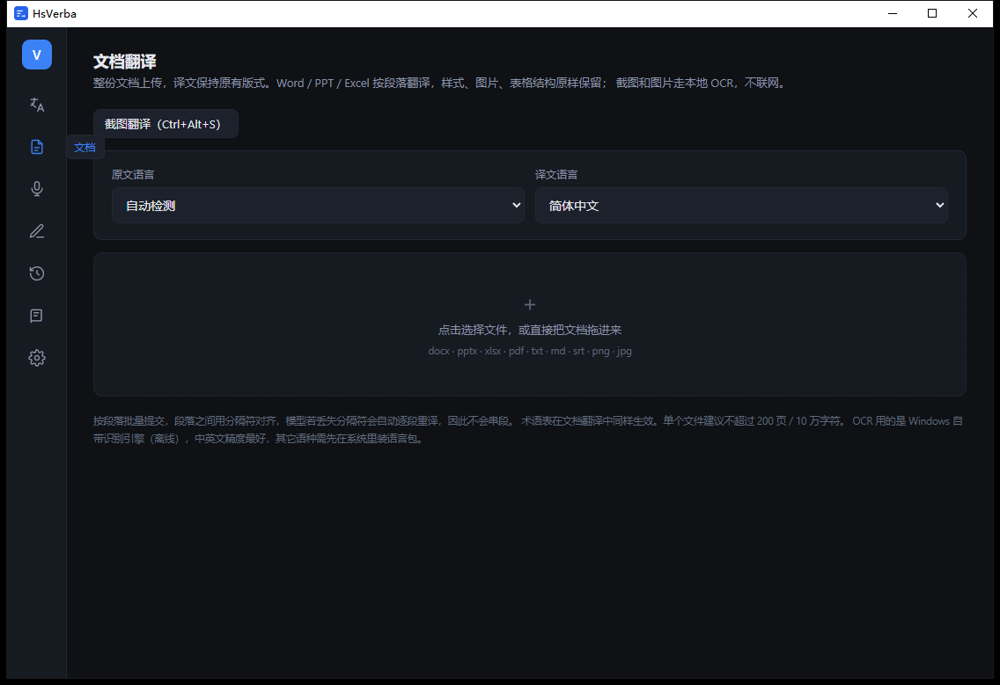
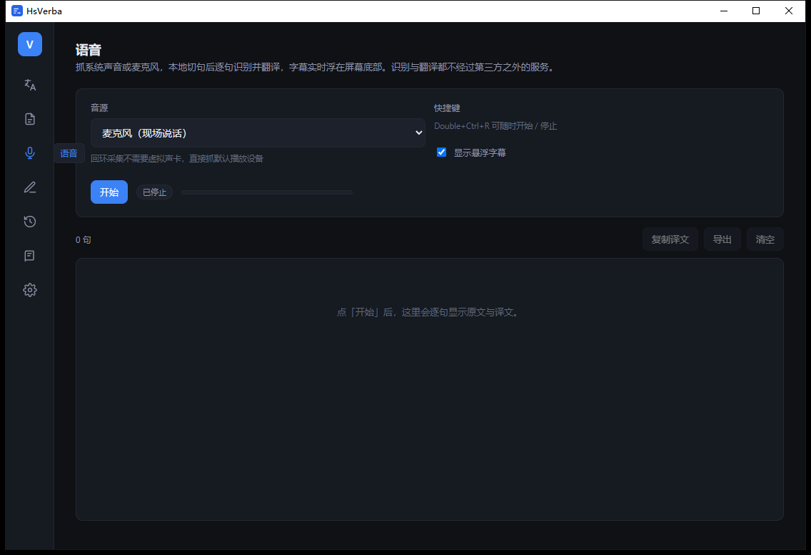
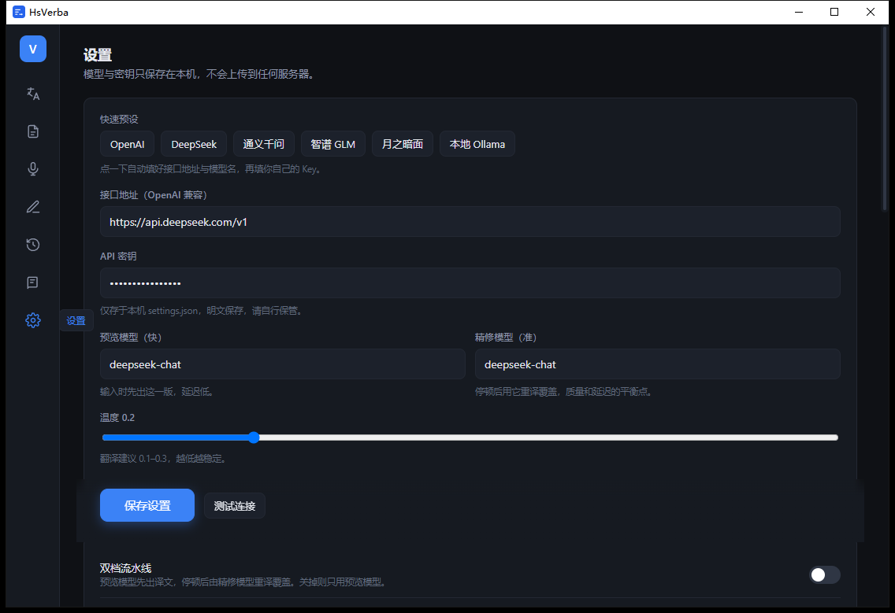

# HsVerba

**本地优先的翻译工作台** —— 一个 exe，把划词翻译、文档翻译、截图 OCR、语音字幕全装进来。自带密钥（BYOK），不经过任何中间服务器。

[功能](#功能) · [下载](#下载) · [快速开始](#快速开始) · [从源码构建](#从源码构建) · [隐私](#隐私与安全) · [详细文档](app/README.md)



---

## 为什么

DeepL 的翻译质量来自它服务端的模型，客户端只是个 131 MB 的壳。HsVerba 反过来做：界面和系统集成全部自建，翻译引擎换成任何 OpenAI 兼容接口——你自己的 OpenAI、DeepSeek、通义、智谱、月之暗面，或者本机跑的 Ollama。

结果是一个 12 MB 左右、不用登录、不用订阅、数据不出本机的同类工具。

## 功能

| 模块 | 能力 |
|---|---|
| **实时翻译** | SSE 流式输出；双档流水线（快档先出译文，停顿 700 ms 后精修档覆盖）；术语表注入 + 译后校验 |
| **划词翻译** | 全局热键抓词 → 鼠标旁浮窗 → 流式译文，可一键复制或送回主窗 |
| **文档翻译** | docx / pptx / xlsx / pdf / txt / md / srt；直接在 OOXML 包内按段落替换，样式、图片、表格、页眉页脚逐字节保留 |
| **截图翻译** | 框选 → Windows 自带 OCR（离线，截图不上传）→ 浮窗流式译文 |
| **语音字幕** | 系统声音回环（看剧、开会、播放器）或麦克风 → 本地 whisper.cpp / 云端 ASR → 屏幕底部置顶透明字幕 |
| **写作助手** | 流式润色与改写 |
| **历史 / 术语表** | SQLite 本地存储，可搜索、可导出 |
| **系统集成** | 托盘常驻、剪贴板监听、双击式全局热键、虚拟键盘点选（不用记组合键） |

<p align="center">
  
  
</p>
<p align="center">
  
</p>

## 下载

到 [Releases](https://github.com/17wxHs/HsVerba/releases) 下载任意一个：

| 文件 | 说明 |
|---|---|
| `HsVerba.exe` | **便携版**，约 8 MB，双击即用，推荐 |
| `HsVerba_1.0.0_x64-setup.exe` | NSIS 安装器，装到当前用户，不需要管理员 |
| `HsVerba_1.0.0_x64_en-US.msi` | MSI，企业批量部署用 |

三个是同一个程序，任选其一。**压缩包里不含任何 API Key。**

系统要求：Windows 10 1809+ / Windows 11，x64。WebView2 在 Win11 与更新的 Win10 上自带。

## 快速开始

1. 双击 `HsVerba.exe`
2. 打开「设置」，点一个预设（OpenAI / DeepSeek / 通义千问 / 智谱 GLM / 月之暗面 / 本地 Ollama），或者直接填任何 OpenAI 兼容的接口地址
3. 填自己的 API Key，点「测试连接」
4. 回到「翻译」页，输入或粘贴文本

热键（都可以在设置里改，也支持点 ⌨ 按钮用虚拟键盘选）：

| 默认热键 | 作用 |
|---|---|
| `Double+Ctrl+C` | 划词翻译（按住 Ctrl 连按两下 C） |
| `Double+Ctrl+V` | 翻译剪贴板内容 |
| `Double+Ctrl+S` | 截图翻译 |
| `Double+Ctrl+R` | 开始 / 停止语音字幕 |
| `Double+Ctrl+D` | 唤出 / 隐藏主窗口 |

## 从源码构建

前置：Node.js 18+、Rust 1.77+、Visual Studio C++ Build Tools（MSVC）。

```bash
git clone https://github.com/17wxHs/HsVerba.git
cd HsVerba/app
npm install
npm run tauri dev     # 开发模式
npm run tauri build   # 产出便携版 + NSIS + MSI
```

首次编译 Rust 依赖要几分钟，之后增量编译约 10 秒。

<details>
<summary>回归测试</summary>

测试脚本走真实管线（真实窗口、真实热键、真实 OCR、真实音频回环），翻译与识别默认接本地 mock：

```bash
cd app
python mock_server.py &          # OpenAI 兼容 mock 引擎（127.0.0.1:8099）
python make_fixtures.py          # 生成 docx/pptx/xlsx/pdf/srt 样本
python p3_test.py                # 文档翻译 31 项
python p4_test.py                # 截图 OCR 7 项
python p5_test.py                # 语音字幕 11 项
python p2_test.py                # 热键 → 浮窗 → 入库 → 托盘
```

脚本自动读取 `%APPDATA%\com.verba.desktop`，不需要改路径。
</details>

## 目录结构

```
app/
  src/                 React 界面（翻译 / 文档 / 语音 / 写作 / 历史 / 术语 / 设置）
  src-tauri/src/       Rust：engine 翻译、doc 文档、ocr 截图、audio+voice 语音、
                       keyhook 双击热键、system 托盘与快捷键、asr 本地识别
  *_test.py            端到端回归
bench/                 双档流水线的盲评数据与结论
docs/screenshots/      界面截图
dist/                  打包产物（不入库，见 Releases）
```

## 隐私与安全

- **密钥只在本机**：`%APPDATA%\com.verba.desktop\settings.json`（明文，便于自己检查；文件权限跟随系统用户）
- **历史与术语表**：`%APPDATA%\com.verba.desktop\verba.db`（SQLite）
- **不外发别的**：唯一的出网流量是发往你自己填的翻译接口；OCR 用 Windows 本地引擎，语音识别可用本地 whisper.cpp，截图和录音都不会上传
- 仓库里不含任何密钥；程序二进制里也不含（配置是运行时读取的），所以可以直接把 exe 发给别人

更多见 [SECURITY.md](SECURITY.md)。

## 已知限制

- 只在 Windows 上构建过（用到 WASAPI 回环、Windows.Media.Ocr、Win32 热键），跨平台需要替换这几个模块
- 翻译质量取决于你接的模型，与界面无关
- PDF 只提取文本层，扫描件请走截图 OCR；OCR 精度取决于系统语言包
- 语音实时字幕是 3 秒固定切片，延迟约 4 秒，换来的是不等停顿、连续对白不断档

## 许可

[HsVerba 非商业许可 1.0](LICENSE) © Hs，保留所有权利。

| | |
|---|---|
| ✅ 可以 | 个人使用、学习、改源码、**免费**转发（原样或改过，保留署名与本许可） |
| ✅ 可以 | 教学、学术研究、非营利组织使用 |
| ❌ 不可以 | 商业使用（含公司在经营/生产中部署） |
| ❌ 不可以 | 二次售卖、收费分发、打包进付费产品、做成收费在线服务 |
| ❌ 不可以 | 去除或隐藏作者署名 |

需要商用请另行取得书面授权。营利组织有 30 天评估期。

> 这是「源码可见（source-available）」许可，不是 OSI 定义的开源许可——因为它限制商业使用。
